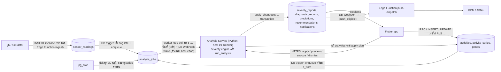
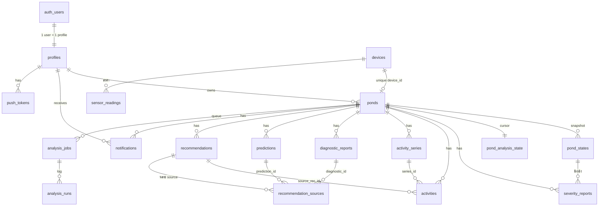
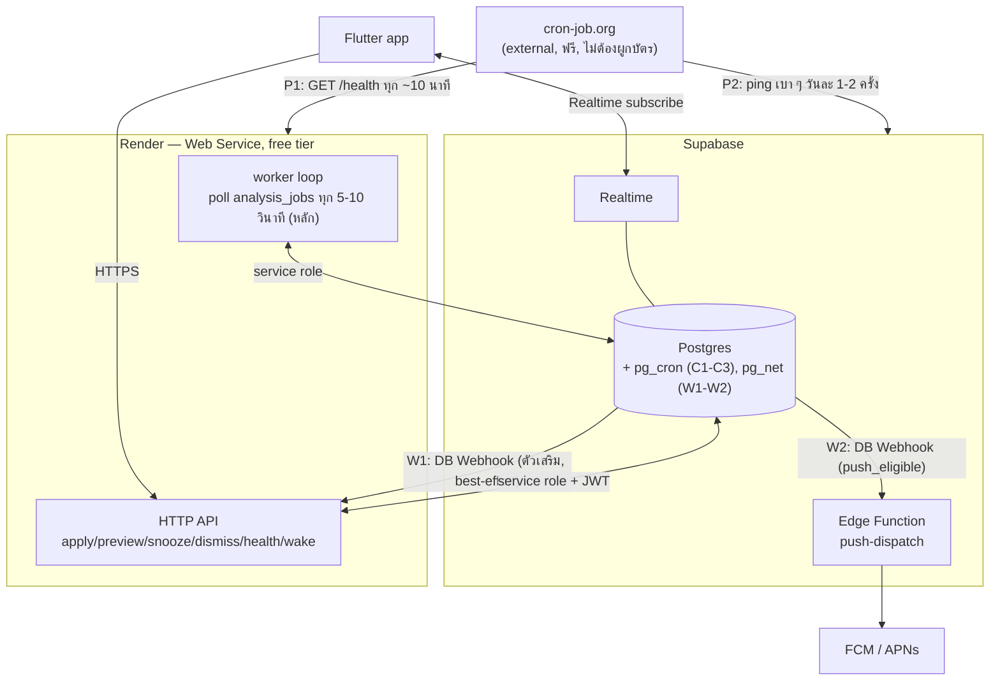

# Database Design v0.2 — Aquanoph บน Supabase

สถานะ: ข้อเสนอ ยังไม่ใช่ข้อสรุป (มี "คำถามที่ต้องตัดสินใจ" ท้ายเอกสาร)
เวอร์ชัน: v0.2 — ปรับจาก v0.1: เพิ่ม §16 (Infrastructure, Hosting และ Keep-alive Strategy) และอัปเดต §8 กับ §14 ข้อ 3 ให้สอดคล้องกับการตัดสินใจเรื่อง hosting ที่สรุปแล้ว ส่วนที่เหลือทั้งหมด (โครงสร้างตาราง, RLS, adapter, flow หลัก) **ไม่เปลี่ยนจาก v0.1**
ขอบเขต: โครงสร้าง table, foreign key, การไหลของข้อมูล, webhook/trigger/cron, RLS สำหรับต้นแบบ (ปลานิล, ออนไลน์เท่านั้น, 1 account = 1 บ่อ แต่ schema รองรับหลายบ่อ)
อ้างอิง: `app_spec_v0_4.md` (§3.9, §5, §10 Part 3), `special_part_retroactive_edits_v0_2.md`, Phase 1–7 ของ Analysis Backend (`Activity`, `PondInfo`, `DiagnosticReport`, `Prediction`, `Recommendation`, `Notification`, `ChangeSet`)

---

## 0. สรุปสั้น

- ข้อมูลมา 4 แหล่ง เรียกด้วยป้ายนี้ทั้งเอกสาร: **[USER]** ผู้ใช้ผ่านแอป Flutter · **[BUOY]** ทุ่น/simulator ที่ส่งค่าเซนเซอร์ · **[BACKEND]** Analysis Backend (Python, ใช้ service role) · **[DB]** trigger / cron / generated column ใน Postgres เอง
- มี table ที่คุณมีอยู่แล้ว 2 ตัว (`devices`, ตารางค่าเซนเซอร์) ที่เหลือเป็นของใหม่ รวมประมาณ 17 ตัว
- **หลักการ 8 ข้อ**
  1. Analysis Backend เป็น pure function (`run_analysis`) ไม่แตะ DB เอง จึงต้องมี **adapter** ที่โหลด snapshot → เรียก → เขียน ChangeSet ใน 1 transaction (§9)
  2. ข้อเท็จจริงเขียนครั้งเดียวไม่แก้ (`sensor_readings`, `severity_reports`) ส่วนการตีความ (`diagnostic_reports`, `predictions`, `recommendations`) เขียนทับด้วย id เดิมพร้อม `revised_at`
  3. id ของสิ่งที่ backend สร้างเป็น **text แบบ deterministic** (`diag:...`, `pred:...`, `rec:...`, `act:...`) ไม่ใช่ uuid เพราะ idempotency ของ ChangeSet ต้องการแบบนี้
  4. ทุก timestamp เป็น `timestamptz` (เก็บ UTC) ส่วน timezone ของบ่อเก็บเป็น IANA id
  5. ไม่มี soft delete ไม่มีตารางประวัติการแก้ (ตามสเปก) ยกเว้น `pond_states` ที่เป็น snapshot ของบ่อสำหรับ report (ดู §3.3 ซึ่งเป็นการตัดสินใจที่ต้องยืนยัน)
  6. user เขียนได้เฉพาะ activity, series, ข้อมูลบ่อ (3 ฟิลด์) ส่วนผลวิเคราะห์ทั้งหมด backend เขียนผ่าน service role (RLS ปิดไม่ให้ user เขียน)
  7. งานวิเคราะห์ถูกจัดคิวใน table `analysis_jobs` ทำทีละบ่อ เหตุการณ์ที่ซ้อนกันรวมเป็นงานเดียวโดยใช้ `t_from` ต่ำสุด (ตาม special part §4)
  8. ห้ามพึ่ง webhook ตัวเดียว (ส่งแบบ fire-and-forget อาจหาย) worker ต้อง poll คิวเป็นทางสำรองเสมอ
- **Hosting (ตัดสินใจแล้ว):** Python Analysis Service host บน **Render free tier** (ไม่ใช้ Google Cloud Run เพราะบังคับผูกบัตรเครดิต, ไม่ใช้ Fly.io เพราะไม่มี free tier แล้ว) คู่กับ **external pinger** (cron-job.org ฟรี) ที่กันไม่ให้ทั้ง Render และ Supabase หลับ/pause — รายละเอียดเต็มอยู่ที่ §16

---

## 1. ภาพรวมการไหลของข้อมูล



ขั้นตอนใน worker ต่อ 1 งาน: (1) รัน severity engine กับ reading ใหม่ → เขียน `severity_reports` (2) โหลด snapshot (3) `run_analysis` (4) เขียน ChangeSet (5) จบงาน

> หมายเหตุ v0.2: edge label ของ `JOBS → WORKER` อัปเดตจาก "poll + webhook wake (ตัวเลือก)" เป็น "worker loop poll ทุก 5-10 วินาที (หลัก) + DB Webhook wake (ตัวเสริม)" ให้ตรงกับการตัดสินใจ hosting ใน §16 — ตัว worker loop ยังเป็นกลไกหลักเหมือนที่ออกแบบไว้ใน v0.1 เดิม เพียงแต่ตอนนี้ยืนยันแล้วว่าทำได้จริงเพราะ Render เป็น container ที่รันต่อเนื่องได้ (ไม่ใช่ serverless แบบ request-per-invocation) ตราบใดที่มี external pinger กันไม่ให้ free tier สั่ง sleep (§16.3)

---

## 2. ตารางสรุป: table ไหน ทำอะไร ข้อมูลมาจากไหน

| Table | หน้าที่ | ผู้เขียน (แหล่งข้อมูล) | ผู้อ่าน |
|---|---|---|---|
| `devices` *(มีอยู่แล้ว)* | ทะเบียนอุปกรณ์ ใช้ตรวจว่า Device ID ที่ user กรอกมีจริง | [DB]/dev (ลงทะเบียนเอง) | ponds (FK) |
| `sensor_readings` *(มีอยู่แล้ว + เพิ่ม 3 คอลัมน์)* | ค่าดิบ 6 parameter ต่อ 1 การวัด ผูกกับ device | [BUOY] | backend, กราฟ Retrospective |
| `profiles` | username ของ user (email อยู่ใน Supabase Auth) | [USER] ตอนสมัคร + [DB] trigger | แอป |
| `ponds` | ข้อมูลบ่อ "ค่าปัจจุบัน" | [USER] (สร้าง, แก้ 3 ฟิลด์) | แอป, backend |
| `pond_states` | snapshot ของบ่อ (น้ำหนัก, จำนวน, density, timezone) ที่ report อ้างอิง | [DB] trigger | backend, แอป (ดู threshold ที่ใช้) |
| `pond_analysis_state` | cursor ของ backend ต่อบ่อ (ประมวลผล reading ถึงไหนแล้ว) | [BACKEND] | backend |
| `severity_reports` | ผลประเมิน severity ต่อ parameter ต่อ reading (zone, severity, ข้อความ) | [BACKEND] (severity engine) | แอป (status, กราฟ), backend (episode) |
| `activities` | checklist: แผนและบันทึก (6 ชนิด) | [USER] + [BACKEND] (จาก Apply) | แอป, backend |
| `activity_series` | แม่แบบของ "ทำซ้ำทุกวัน" | [USER] + [DB] cron ต่ออายุ | cron |
| `diagnostic_reports` | สาเหตุของ episode ที่ parameter ผิดปกติ (พร้อมหลักฐาน) | [BACKEND] | แอป |
| `predictions` | คำพยากรณ์ความเสี่ยง (3 rule) | [BACKEND] | แอป |
| `recommendations` | คำแนะนำ (3 entry) พร้อมสถานะ | [BACKEND] สร้าง/ปรับ/หมดอายุ; [USER] ตัดสินใจผ่าน API | แอป |
| `recommendation_sources` | อ้างว่า rec นี้มาจาก prediction/diagnostic/detector ตัวไหน (หลาย source ได้, O3) | [BACKEND] | backend (ตรวจ "source ปิดหมดหรือยัง") |
| `notifications` | outbox การแจ้งเตือน (ไม่ส่งเอง, O5) + feed ในแอป | [BACKEND] + [DB] trigger (severity Critical) | แอป, push-dispatch |
| `push_tokens` | token FCM/APNs ของอุปกรณ์ user | [USER] | push-dispatch |
| `analysis_jobs` | คิวงานวิเคราะห์ต่อบ่อ | [DB] triggers/cron | worker |
| `analysis_runs` | log ของแต่ละการรัน (audit, ดีบัก, วัดเวลา) | [BACKEND] | dev |
| `app_config` | ค่าที่ DB/แอปต้องรู้ (retro window, ลำดับ parameter, ฯลฯ) | dev | แอป, trigger |

View/function อ่านอย่างเดียว: `v_pond_cards`, `v_pond_status`, `v_activities` (คำนวณ `missed`), `v_recommendations` (พ่วง parameter ที่เกี่ยวข้อง), `get_retrospective(pond, from, to)` (min/max/avg, จำนวนครั้ง HighRisk/Critical, เวลาในแต่ละโซน)

---

## 3. รายละเอียดต่อ table

ชนิดข้อมูลหลัก: `uuid` สำหรับ entity ที่ผู้ใช้สร้าง, `text` สำหรับ id ที่ backend สร้างแบบ deterministic, `timestamptz` ทุกเวลา

### 3.1 กลุ่มที่มีอยู่แล้ว

**`devices`** — device_id (PK), รายละเอียดอุปกรณ์ตามที่มี ไม่แก้โครงสร้าง

**`sensor_readings`** — ค่าดิบ แหล่ง: [BUOY]
- ที่มีอยู่: `device_id` (FK → devices), `measured_at` (UTC), คอลัมน์ค่า `DO, pH, NH3, NO2, temperature, salinity`
- **เพิ่ม:** `id bigint identity` (ถ้ายังไม่มี PK), `received_at timestamptz default now()`, `late boolean` (L6: เก็บ raw พร้อม flag ไม่คำนวณ severity ย้อนหลังใหม่)
- unique `(device_id, measured_at)` กันส่งซ้ำ · index `(device_id, measured_at desc)`
- `late` ตั้งโดย [DB] trigger: `true` เมื่อ `measured_at` ≤ เวลาล่าสุดที่ประมวลผลแล้วของ device นั้น (ผิดลำดับ) ส่วนค่าที่มาช้าแต่ยังใหม่สุดไม่ถือว่า late (ดูคำถามข้อ 4)
- คอลัมน์ค่าเป็น `numeric` null ได้ (sensor ขาดบางตัว) ค่า NaN ห้ามเก็บ (ตรวจที่ ingestion เพราะ engine จะ raise `ValueError`)

### 3.2 Account

**`profiles`** — `user_id uuid PK → auth.users(id) on delete cascade`, `username citext unique not null`, `created_at`
- [DB] trigger บน `auth.users` insert สร้างแถวจาก metadata ที่ส่งตอนสมัคร (email + username ห้ามซ้ำแบบไม่แยกตัวพิมพ์ ตามสเปก §3.1 ใช้ `citext`)

### 3.3 Pond

**`ponds`** — แหล่ง: [USER]

| คอลัมน์ | ชนิด | หมายเหตุ |
|---|---|---|
| `id` | uuid PK | |
| `user_id` | uuid FK → profiles | RLS key |
| `name` | text | **แก้ได้** |
| `area_m2`, `avg_depth_m` | numeric > 0 | แก้ไม่ได้ |
| `species` | enum (`nile_tilapia`) | แก้ไม่ได้ |
| `stocking_count` | int > 0 | **แก้ได้** (ตรงกับ `PondInfo.fishCount`) |
| `avg_weight_g` | numeric > 0 | **แก้ได้** (`PondInfo.avgWeightG`) |
| `stocking_date` | date | แก้ไม่ได้ |
| `device_id` | FK → devices, **unique, not null** | แก้ไม่ได้ |
| `timezone` | text (IANA) | แก้ไม่ได้ ตรวจด้วยฟังก์ชัน `is_valid_timezone()` |
| `volume_m3`, `biomass_kg`, `density_kg_m3` | generated stored | `area*depth`, `count*weight/1000`, `biomass/volume` (= `PondInfo.biomassKg`) |
| `analysis_start_at` | timestamptz | [DB] BEFORE INSERT = `max(stocking_date ณ เที่ยงคืน local, created_at)` (N2) ไม่เปลี่ยนอีก |
| `created_at`, `updated_at` | timestamptz | `updated_at` โดย trigger |

- แก้ไม่ได้ = ใช้ **column-level GRANT** (`grant update (name, avg_weight_g, stocking_count) on ponds to authenticated`) บวก trigger ปฏิเสธการแก้คอลัมน์อื่นจาก role ที่ไม่ใช่ service/dev
- ไม่มี policy DELETE (ไม่มีหน้าลบบ่อ) · เกินสเปก: จำกัด 1 บ่อต่อ user ที่ชั้น UI ไม่ใช่ DB
- trigger หลังแก้ `avg_weight_g` หรือ `stocking_count`: (1) insert `pond_states` (2) `enqueue_analysis(pond, 'pondEdit')` การแก้ `name` ไม่ทำอะไร (ตามที่ `pondEditTrigger` ใน Phase 7 กำหนด)

**`pond_states`** — snapshot ของบ่อ แหล่ง: [DB] trigger (insert-only, ห้าม update/delete)
- `id uuid PK`, `pond_id FK`, `effective_from timestamptz`, `avg_weight_g`, `fish_count`, `biomass_kg`, `density_kg_m3`, `volume_m3`, `timezone`
- แถวแรกสร้างตอนสร้างบ่อ แถวใหม่ทุกครั้งที่แก้น้ำหนัก/จำนวน
- ทำไมต้องมี: threshold ของ DO ขึ้นกับน้ำหนัก และสเปก §3.9 ให้ report เก็บ snapshot แต่ `severity_reports` มีปริมาณสูง (288 แถว/วัน/บ่อ) จึงอ้างด้วย FK แทนการ copy
- **ขัดกับ "ไม่มีประวัติการแก้ pond" ในสเปกหรือไม่:** ไม่มี UI ดูประวัติ ใช้เป็น snapshot ของ report เท่านั้น แต่ต้องยืนยัน (คำถามข้อ 1)

**`pond_analysis_state`** — `pond_id PK FK`, `last_reading_at` (reading ล่าสุดที่ severity engine ประมวลผลแล้ว), `last_run_at`, `engine_version`. แหล่ง: [BACKEND] ใช้เป็น cursor และเป็นตัวตัดสิน `late`

### 3.4 Severity (ข้อเท็จจริง ไม่แก้)

**`severity_reports`** — แหล่ง: [BACKEND] (severity engine เดิม ห้ามเปลี่ยน logic)

| คอลัมน์ | หมายเหตุ |
|---|---|
| `id bigint identity` PK | |
| `pond_id` FK, `pond_state_id` FK → pond_states | |
| `parameter` enum | `DO, NH3, NO2_N, pH, Temperature, Salinity` |
| `measured_at` timestamptz | |
| `value` numeric | ค่าที่วัด (F-01: `AnalysisReportModel.value`) |
| `zone` enum | `optimal, stress, high_risk, critical` (threshold zone) |
| `direction` enum null | `low/high` เฉพาะ Range threshold (pH, Temperature) ตอนที่ไม่ Optimal |
| `severity` enum | `optimal, stress, elevated_risk, critical` |
| `recovering` | generated: `zone='optimal' and severity='stress'` (Recovery Hold) |
| `symptom`, `reason`, `guidance` text | ข้อความ English จาก engine ที่แอปแสดงในการ์ด parameter |
| `engine_version`, `reading_id` FK null | |

- **unique `(pond_id, parameter, measured_at)`** → รันซ้ำ reading เดิมได้ (`insert ... on conflict do nothing`) ตรงกับ idempotency ของ engine
- insert-only ห้าม update/delete (ข้อเท็จจริงไม่เปลี่ยน, Rule 6) · index `(pond_id, parameter, measured_at desc)`
- ชื่อ enum ใน DB เป็นชื่ออ่านง่าย adapter แปลงจากชื่อในโค้ด (`tem` → `Temperature`, `HighRisk "hight risk"` → `high_risk`, `NO2_N`) เพื่อไม่ให้ typo ของโค้ดไหลเข้า DB

### 3.5 Checklist

**`activities`** — แหล่ง: [USER] (ฟอร์ม, ติ๊ก Save) และ [BACKEND] (Apply สร้างรายการ `source=recommendation` และแก้รายการ pending ของ user ตามกฎ D15/D17)

| คอลัมน์ | หมายเหตุ |
|---|---|
| `id text PK` | user: `gen_random_uuid()::text` · backend: `act:{recId}:{i}` |
| `pond_id` FK | |
| `type` enum | `feeding, aeration, alkalinity, lime, probiotic, water_change` (backend: `waterChange` ↔ `water_change`; `other` removed per CONFIG_RESOLUTION ข้อ 4) |
| `status` enum | `pending, done, skipped` (`missed` ไม่เก็บ คำนวณใน view) |
| `start_time`, `end_time` | `end_time` ต้องมีเมื่อ `aeration` เท่านั้น |
| `quantity_kg numeric >= 0`, `fraction numeric (0,1]` | `fraction` เฉพาะ `water_change` |
| `source` enum (`user`, `recommendation`) | |
| `source_rec_id text` FK → recommendations | not null ⇔ `source='recommendation'` |
| `series_id uuid` FK → activity_series, null | |
| `created_at`, `updated_at` | |

Constraint ที่ DB บังคับ (สะท้อน `Activity.__post_init__` ของ Phase 1):
- `check` ทุกข้อข้างต้น (aeration ต้อง `end_time > start_time`, ชนิดอื่นห้ามมี `end_time`, `fraction` เฉพาะ water_change, `source_rec_id` ⇔ source)
- **aeration ซ้อนกันบล็อกเด็ดขาด** (สเปก §3.4): exclusion constraint แบบ `deferrable initially deferred` (จำเป็น เพราะ Apply แบบ D15 ลบ/ตัดรายการเดิมแล้วสร้างรายการใหม่ใน transaction เดียว)
  ```sql
  exclude using gist (pond_id with =, tstzrange(start_time, end_time) with &&)
    where (type = 'aeration' and status <> 'skipped')
    deferrable initially deferred
  ```
- trigger BEFORE UPDATE/DELETE (ใช้กับ role `authenticated` เท่านั้น ไม่บล็อก service role) เป็น **guard คู่ขนาน** กับ `validateActivityEdit` ของ Phase 7:
  - ห้ามย้อนสถานะ `done/skipped → pending` (`status_rollback`)
  - ห้ามลบรายการ `source=recommendation`
  - ห้ามแก้ `id, pond_id, source, source_rec_id, created_at`
  - ห้ามเพิ่ม/แก้/ลบรายการที่ `start_time` (เก่าหรือใหม่) เก่ากว่า `now() - retro_window_days` (ค่า 4 จาก `app_config`); อนาคตแก้ได้ไม่จำกัด
  - ห้าม user ใส่ `source='recommendation'` เอง
- trigger AFTER (statement-level, ใช้ transition table) → `enqueue_analysis(pond, 'activityEvent', min(t_from))` โดย `t_from` = ตามตารางใน special part §2 (เพิ่ม = เวลาใหม่, ลบ = เวลาเก่า, แก้ = ต่ำสุดของเก่า/ใหม่) การ Save แบบ batch ที่อยู่ใน transaction เดียวจึงได้งานเดียว
- index `(pond_id, start_time)`, `(pond_id, type, status)`, `(source_rec_id)`

**`activity_series`** — แม่แบบ "ทำซ้ำทุกวัน" แหล่ง: [USER] สร้าง, [DB] cron ต่ออายุ
- `id uuid PK`, `pond_id FK`, `type`, `local_start_time time`, `duration_minutes` (aeration), `quantity_kg`/`fraction`, `first_local_date date`, `ended_at null`, `generated_through date`
- cron รายวัน `renew_activity_series()` สร้างรายการ `pending` ล่วงหน้า 7 วันตาม timezone ของบ่อ (สเปก §3.4, Part 3) · แก้ "ตั้งแต่วันนี้เป็นต้นไป" = แก้ template + รายการ `pending` ที่ยังไม่ถึง
- ถ้าชนกับ aeration เดิม (exclusion constraint) ให้ข้ามวันนั้นและบันทึกใน `analysis_runs`/log ไม่ล้มทั้งงาน

### 3.6 ผลวิเคราะห์ (backend เขียนทั้งหมด ผ่าน service role)

**`diagnostic_reports`** — 1 แถว = 1 episode (map 1:1 กับ `DiagnosticReport`)
- `id text PK` (`diag:...`), `pond_id FK`, `parameter`, `direction null`, `onset_at`, `end_at null`, `status (open/closed)`, `peak_severity`, `last_severity`
- `causes jsonb` = `[{rule_id, facts}]` (หลักฐานเก็บในตัว report เอง ตามสเปก §3.2 เพื่อให้ activity ถูกลบแล้วยังอธิบายได้)
- `no_clear_cause bool`, `pond_snapshot jsonb` (= `PondInfo` ตอนวิเคราะห์), `revised_at null`, `created_at`
- `text jsonb` = ผลของ `renderDiagnostic` (cache เพื่อให้ Flutter แสดงโดยไม่ต้องมี logic ข้อความ) adapter เติมตอนเขียน
- index `(pond_id, onset_at desc)`, `(pond_id, parameter, status)` · ห้ามลบ

**`predictions`** — map 1:1 กับ `Prediction`
- `id text PK` (`pred:...`), `pond_id FK`, `rule_id`, `scope text null`, `parameter`, `expected_zone`, `risk_start`, `risk_end`, `met text[]`, `status (active/ended)`, `end_reason null` (`mitigated/conditions_gone/window_over`), `evidence jsonb`, `pond_snapshot jsonb`, `created_at`, `revised_at null`, `text jsonb`
- partial unique `(pond_id, rule_id) where status='active'` (Phase 4: active ได้ครั้งละ 1 ต่อ rule)

**`recommendations`** — map 1:1 กับ `Recommendation`
- `id text PK` (`rec:...`), `pond_id FK`, `entry_id` (`AERATE/WATER_CHANGE/ADD_ALKALINITY`), `dedupe_key text`, `urgency (urgent/non_urgent)`, `apply_mode (fixed/pick_window)`
- `valid_from`, `valid_until`, `title`, `reason`, `based_on`, `guidance text[]`, `proposed_activities jsonb`, `plan_text` (จาก `renderPlan` เพราะ model ไม่มี field นี้)
- `status (pending/snoozed/applied/dismissed/expired)`, `expire_reason null` (`no_longer_applies/time_window_over`), `snooze_until null`, `created_at`, `updated_at`
- **partial unique `(pond_id, dedupe_key) where status in ('pending','snoozed')`** = "ไม่สร้างซ้ำถ้ามี pending ที่ dedupe_key เดียวกัน" ระดับ DB
- check: `snoozed` ⇔ `snooze_until is not null`; `expired` ⇔ `expire_reason is not null`; urgent ห้าม `snoozed`
- index `(pond_id, status, valid_until)`, `(pond_id, dedupe_key)`
- ไม่เก็บ `text_key` / draft facts (ChangeSet ไม่ส่งมา)

**`recommendation_sources`** — O3: rec หนึ่งมีได้หลาย source
- `rec_id text FK → recommendations on delete cascade`
- `source_type enum (episode/prediction/detector)` และ **FK จริง 2 ทาง**: `diagnostic_id text FK → diagnostic_reports` / `prediction_id text FK → predictions` / `detector_code text` (เช่น `PH_SWING:{pond}`) โดย `check` ให้มีค่าเพียงหนึ่งใน 3 ตามชนิด
- PK `(rec_id, source_type, coalesce(diagnostic_id, prediction_id, detector_code))`
- FK ฝั่ง source เป็น `on delete restrict` → ห้ามลบ diagnostic/prediction ที่ยังถูกอ้าง (สำคัญต่อ retention §12)

### 3.7 งานเบื้องหลังและการแจ้งเตือน

**`analysis_jobs`** — คิวต่อบ่อ แหล่ง: [DB] (trigger/cron) → worker อ่าน/อัปเดต

| คอลัมน์ | หมายเหตุ |
|---|---|
| `id bigint identity` PK, `pond_id` FK | |
| `status` | `queued / running / done / failed` |
| `kinds text[]` | ชุดของ `reading, activityEvent, pondEdit, tick` ที่รวมกันอยู่ |
| `activity_t_from timestamptz null` | ต่ำสุดของ `t_from` ของ activityEvent ที่รวม |
| `run_after`, `attempts`, `locked_at`, `locked_by`, `last_error`, `created_at`, `started_at`, `finished_at` | |

- **partial unique `(pond_id) where status='queued'`** → มีงานรอได้ 1 งานต่อบ่อ; **partial unique `(pond_id) where status='running'`** → รันได้ทีละงานต่อบ่อ
- `enqueue_analysis(pond, kind, t_from)` ใช้ `insert ... on conflict (pond_id) where status='queued' do update` รวม `kinds` (union) และ `activity_t_from = least(...)` ตามกฎ "รวมเป็นงานเดียวด้วย t_from ต่ำสุด"
- worker หยิบงานด้วย `for update skip locked` เมื่อ `run_after <= now()`; ถ้างานเดียวมีหลาย kind ให้รัน `run_analysis` ตามลำดับ `activityEvent → pondEdit → reading → tick` โดยเขียน ChangeSet ระหว่างรัน (แต่ละรอบ idempotent) ไม่ใช่รวมเป็น trigger เดียว เพราะ `Trigger` มี kind เดียว
- ล้มเหลว: `attempts+1`, `run_after = now() + backoff` ผลเดิมคงอยู่ (special part §4 ข้อ 5); เกิน N ครั้ง → `failed` + แจ้ง dev

**`analysis_runs`** — log: `job_id`, `pond_id`, `trigger_kind`, `now_at`, `t_from`, จำนวนวัตถุต่อชนิดใน ChangeSet, `duration_ms`, `error`, `engine_version` แหล่ง: [BACKEND] ใช้ดีบักและพิสูจน์ idempotency (รันซ้ำแล้วต้องได้ ChangeSet ว่าง)

**`notifications`** — outbox + feed ในแอป (O5: เป็นแค่แถวใน DB ไม่ได้ส่งเอง)
- `id bigint identity`, `pond_id FK`, `user_id FK` (denormalize เพื่อ RLS), `kind`, `target_type`, `target_id text`, `reason_key`, `facts jsonb`, `text` (จาก `renderNotification`), `push_eligible bool`, `pushed_at null`, `read_at null`, `created_at`
- ชนิดจาก backend: `urgentRecCreated, recChanged, recExpired, recUnsnoozed, predictionEnded, activityReplaced`
- ชนิดจาก [DB] trigger: **`severityCritical`** เมื่อ `severity_reports` insert แถว `severity='critical'` ที่ก่อนหน้านี้ของ parameter เดียวกันไม่ใช่ critical (ทำที่ DB เพราะ ChangeSet ไม่มี kind นี้ และสเปก §3.7 ต้องการ push กรณี Critical)
- `push_eligible = true` เฉพาะ `severityCritical`, `urgentRecCreated` และ `recChanged` ที่ `reason_key='rec.changed.urgency_raised'` (T8)

**`push_tokens`** — `id`, `user_id FK`, `token unique`, `platform`, `created_at`, `last_seen_at` แหล่ง: [USER] (แอปลงทะเบียนตอน login)

**`app_config`** — key/value (`text`, `jsonb`): `retro_window_days=4`, `param_priority=["DO","NH3","NO2_N","Temperature","pH","Salinity"]`, `tick_minutes=30`, `late_policy`, ฯลฯ
- แหล่งความจริงของ `AnalysisConfig` ยังอยู่ในโค้ด (`config/constants.py`) ตารางนี้เก็บเฉพาะค่าที่ trigger/แอปใช้ ต้องมี test เทียบกันกัน drift

---

## 4. ER diagram



## 5. สรุป foreign key และพฤติกรรมเมื่อลบ

| FK | on delete | เหตุผล |
|---|---|---|
| `profiles.user_id → auth.users` | cascade | ลบบัญชีนอกขอบเขตต้นแบบ แต่กัน orphan |
| `ponds.user_id → profiles` | restrict | ไม่มีหน้าลบบ่อ/บัญชี dev ลบเอง |
| `ponds.device_id → devices` | restrict | |
| `sensor_readings.device_id → devices` | restrict | |
| `pond_states / severity_reports / activities / activity_series / diagnostic_reports / predictions / recommendations / notifications / analysis_jobs .pond_id → ponds` | restrict | ลบบ่อ = งาน dev ที่ทำเป็นสคริปต์ลบตามลำดับ |
| `severity_reports.pond_state_id → pond_states` | restrict | |
| `activities.source_rec_id → recommendations` | restrict | |
| `activities.series_id → activity_series` | set null | ลบ series ไม่ลบประวัติ |
| `recommendation_sources.rec_id → recommendations` | cascade | |
| `recommendation_sources.diagnostic_id / prediction_id → …` | restrict | |
| `analysis_runs.job_id → analysis_jobs` | cascade | |

## 6. Enum และการแปลงชื่อ (adapter)

| Domain (โค้ด) | DB |
|---|---|
| `PondParameters.tem` | `Temperature` |
| `PondParameters.NO2_N` (label `NO2-_N`) | `NO2_N` |
| `ThresholdLevelType.HighRisk` (value `"hight risk"`) | `high_risk` |
| `SeverityLevelType.ElevatedRisk` | `elevated_risk` |
| `ActivityType.waterChange`, `Urgency.nonUrgent`, `ApplyMode.pickWindow` | `water_change`, `non_urgent`, `pick_window` |

Adapter ต้องมีตารางแปลงเดียวและ test ไป-กลับครบทุก member

---

## 7. Flow หลัก (ใครเรียกอะไร)

1. **Reading ใหม่:** [BUOY] insert `sensor_readings` → trigger ตั้ง `late` และหา pond จาก `device_id` → `enqueue_analysis(pond,'reading')` (ข้ามถ้า `measured_at < analysis_start_at`) → worker: severity engine กับ reading ที่ยังไม่ประมวลผล (ไม่ใช่ `late`) → insert `severity_reports` → `run_analysis(Trigger(reading))` → apply ChangeSet
2. **User Save checklist / แก้ activity:** แอปเรียก RPC `save_checklist(pond, changes jsonb)` (1 transaction, all-or-nothing) → guard triggers → enqueue `activityEvent` พร้อม `t_from` → worker รัน → Realtime ดัน rec/diag ที่เปลี่ยนไปที่แอป
3. **Apply recommendation:** แอป → `POST /recommendations/{id}/apply` (Python API, ยืนยัน JWT) พร้อม `chosen_time`/`confirmed` → โหลด snapshot → `buildApplyPlan` → ถ้า `applied` เขียน ChangeSet (rec = applied, activity ops, notification `activityReplaced`) ใน 1 transaction ที่ล็อกแถว rec ด้วย `for update` → enqueue `activityEvent(t_from = start ของ activity ใหม่)` · ถ้า `needsDecision`/`rejected` ตอบกลับไม่เขียนอะไร · `POST .../preview` ใช้ฟังก์ชันเดียวกันโดยไม่เขียน (แสดงการตัดรายการก่อน Apply, D17)
4. **Snooze / Dismiss:** `POST /recommendations/{id}/snooze|dismiss` → `snoozeRec`/`dismissRec` → เขียน → ไม่ต้อง enqueue (ไม่กระทบการวิเคราะห์) แต่ `dismissed` มีผลต่อ `blocked()` รอบถัดไป
5. **Tick ทุก 30 นาที:** pg_cron enqueue `tick` ทุกบ่อ → ใช้สำหรับ prediction หมดช่วง, rec หมดเวลา, snooze ครบ, `PRED_NH3_RISE` ขยับ `riskEnd`
6. **แก้บ่อ (น้ำหนัก/จำนวน):** trigger สร้าง `pond_states` ใหม่ + enqueue `pondEdit` (ไม่แตะ diagnostic เก่า)
7. **Repeat series:** cron รายวัน `renew_activity_series()` → สร้าง activity ล่วงหน้า → trigger enqueue `activityEvent` ตามปกติ
8. **Push:** insert `notifications` ที่ `push_eligible` → DB Webhook → Edge Function `push-dispatch` → FCM/APNs → อัปเดต `pushed_at`

---

## 8. Webhook, trigger, cron, endpoint ที่ต้องมี

| # | ชนิด | ตัวกระตุ้น | ทำอะไร | หมายเหตุ |
|---|---|---|---|---|
| W1 | Database Webhook (pg_net → HTTP) | INSERT `analysis_jobs` | แจ้ง `analysis-worker /wake` เพื่อลดหน่วง | **ตัวเสริม ไม่บังคับ** — กลไกหลักคือ worker loop ที่ host บน Render poll เองทุก 5-10 วินาที (ดู §16.5) webhook นี้ใช้ fire-and-forget timeout สั้น หายได้ ไม่กระทบความถูกต้อง |
| W2 | Database Webhook | INSERT `notifications` where `push_eligible` | เรียก Edge Function `push-dispatch` | เก็บ secret ใน Supabase Vault ส่ง retry เองจากตาราง (`pushed_at is null`) ด้วย cron นาทีละครั้ง |
| T1 | DB trigger | INSERT `sensor_readings` | ตั้ง `late`, enqueue `reading` | ไม่เรียก HTTP ใน trigger นี้ |
| T2 | DB trigger (statement) | INSERT/UPDATE/DELETE `activities` | guard (§3.5) + enqueue `activityEvent` | transition table หา `t_from` |
| T3 | DB trigger | UPDATE `ponds` (น้ำหนัก, จำนวน) | insert `pond_states` + enqueue `pondEdit` | |
| T4 | DB trigger | INSERT `ponds` | insert `pond_states` แถวแรก, ตั้ง `analysis_start_at`, สร้าง `pond_analysis_state` | |
| T5 | DB trigger | INSERT `severity_reports` | สร้าง notification `severityCritical` เมื่อเพิ่งเข้า critical | |
| T6 | DB trigger | `auth.users` INSERT | สร้าง `profiles` | |
| T7 | DB trigger | ทุก table ที่มี `updated_at` | ตั้ง `updated_at` | |
| C1 | pg_cron | ทุก 30 นาที | `enqueue_analysis(pond,'tick')` ทุกบ่อ | |
| C2 | pg_cron | รายวัน | `renew_activity_series()` | |
| C3 | pg_cron | รายวัน | ลบ `analysis_jobs` ที่ `done` เกิน 7 วัน, ปลด lock งาน `running` ที่ค้าง (heartbeat เกิน N นาที) | |
| E1 | Edge Function `ingest` (ตัวเลือก) | HTTPS จากทุ่นจริง | ตรวจ API key ของ device, ตรวจ NaN, insert `sensor_readings` | ต้นแบบใช้ service role insert จาก simulator ไปก่อน |
| E2 | Edge Function `push-dispatch` | W2 | ส่ง FCM/APNs ตาม `push_tokens` | |
| A1 | Python API (นอก Supabase) | แอป | `apply`, `preview`, `snooze`, `dismiss` (+ `/health`, `/wake`) | ใช้ JWT ของ Supabase ตรวจสิทธิ์เจ้าของบ่อ — **`/health` ห้ามแตะ DB** (ใช้โดย external pinger เท่านั้น ดู §16.5) |
| R1 | RPC (SQL function) | แอป | `save_checklist`, `upsert_activity`, `delete_activity`, `create_pond`, `get_retrospective` | `security invoker` ใช้ RLS ปกติ |
| P1 *(ใหม่ v0.2)* | External cron (cron-job.org, นอกระบบทั้งหมด) | ตามเวลา ทุก ~10 นาที | `GET` endpoint `/health` ของ Render | กัน Render free tier sleep (ดู §16.3) |
| P2 *(ใหม่ v0.2)* | External cron (cron-job.org) | ตามเวลา วันละ 1-2 ครั้ง | เรียก endpoint เบา ๆ ของ Supabase (เช่น PostgREST อ่านตารางเล็ก ๆ) | กัน Supabase free tier project pause (ดู §16.3) |

**Python Analysis Service ต้อง host นอก Supabase** (Edge Function รันได้เฉพาะ Deno/TypeScript ไม่รันไลบรารี Python นี้ได้) — **ตัดสินใจแล้ว (รายละเอียดเต็มที่ §16): host บน Render free tier** 1 container เดียวที่รันทั้ง worker loop (poll `analysis_jobs` ภายในทุก 5-10 วินาที ตามแผนเดิม) และ HTTP API (`apply/preview/snooze/dismiss/health/wake`) ในโปรเซสเดียวกัน

---

## 9. Adapter (หัวใจของ Phase 8)

**`load_snapshot(pond_id, now) -> PondSnapshot`**
- `pond`: `ponds` + `pond_states` ล่าสุด → `PondInfo`
- `severityReports`: `severity_reports` ตั้งแต่ `max(analysis_start_at, now − historyHorizonDays)` ขึ้นไป (≥ 8 วันตาม Rule 12) เรียงเวลา → `toViews` · ตัดการสแกนไม่จำกัด (BACKLOG เดิม)
- `activities`: ตั้งแต่ `now − max(historyHorizon, retroWindow)` + ทุกรายการ `pending` ในอนาคต
- `diagnostics`: onset อยู่ใน horizon หรือ `open` · `predictions`: `active` + ที่จบใน horizon
- `recommendations`: `pending/snoozed` ทั้งหมด + ที่ `valid_until ≥ now − 1 วัน` + ทุกใบที่มี activity `pending/done` อ้างอยู่ (จำเป็นต่อ `blocked()`) + ทุกใบที่ `dismissed` ใน `valid_until` ยังไม่ผ่าน

**`apply_changeset(pond_id, changeset, snapshot_versions)` — 1 transaction**
1. upsert `diagnostic_reports`, `predictions` ด้วย id (full-object) เติม `text` จาก renderer
2. `recommendations`: `select ... for update` แล้ว **เทียบ `updated_at` กับค่าใน snapshot** ถ้าไม่ตรง (user เพิ่ง dismiss/snooze/apply ระหว่างที่ worker คำนวณ) → `rollback` โยน `StaleSnapshot` → งานถูก requeue (`run_after = now`) ป้องกัน worker เขียนทับสถานะที่ user เพิ่งตัดสินใจ
3. upsert `recommendation_sources` (union; ไม่ลบ source เก่า)
4. `activityOps` (create = `on conflict do nothing`, update, delete) — ปกติ worker ไม่มี op พวกนี้ (เกิดจาก API apply เท่านั้น)
5. insert `notifications` (เติม `pond_id`, `user_id`, `text`, `push_eligible`)
6. insert `analysis_runs`, อัปเดต `pond_analysis_state`, ปิดงาน
- ChangeSet ว่าง = ไม่เขียนอะไร (นอกจาก `analysis_runs`) · รันซ้ำด้วยข้อมูลเดิมต้องได้ ChangeSet ว่าง (พิสูจน์ใน test เชื่อม DB จริง)

**Rule ที่ adapter ต้องไม่ละเมิด:** ไม่เรียก `datetime.now()` ในชั้น logic (ส่ง `now` เข้าไป), ไม่แปลงเวลาเป็น local ก่อนเข้า logic (ส่ง naive UTC), ข้อมูลที่ขาดคือ "ไม่ทราบ" ไม่ใช่ "ไม่ได้ทำ"

---

## 10. RLS และความปลอดภัย

หลัก: ทุก table เปิด RLS · helper `private.owns_pond(pond_id uuid)` (`stable security definer`, เรียก `(select auth.uid())` ห่อเป็น subquery เพื่อให้ planner cache) · service role ข้าม RLS

| Table | user อ่าน | user เขียน |
|---|---|---|
| `profiles` | ของตัวเอง | แก้ username ของตัวเอง |
| `ponds` | ของตัวเอง | insert ของตัวเอง; update เฉพาะ 3 คอลัมน์ (column grant) ; ไม่มี delete |
| `pond_states`, `severity_reports`, `diagnostic_reports`, `predictions`, `recommendations`, `recommendation_sources`, `pond_analysis_state` | บ่อของตัวเอง | **ไม่ได้** (backend เท่านั้น) |
| `sensor_readings` | แถวของ device ที่ผูกกับบ่อตัวเอง และ `measured_at ≥ analysis_start_at` | ไม่ได้ |
| `activities`, `activity_series` | บ่อของตัวเอง | insert/update/delete บ่อตัวเอง ภายใต้ guard triggers (`source='user'` เท่านั้น) |
| `notifications` | ของตัวเอง | update `read_at` เท่านั้น |
| `push_tokens` | ของตัวเอง | ทั้งหมดของตัวเอง |
| `analysis_jobs`, `analysis_runs`, `app_config` | ไม่ได้ (config อ่านได้) | ไม่ได้ |

- service role key อยู่ในเซิร์ฟเวอร์ Python และ Vault เท่านั้น ไม่ลงแอป
- API ของ Python ต้องตรวจว่า JWT เป็นเจ้าของบ่อของ rec นั้น (อย่าเชื่อ `pond_id` จาก body)
- `sensor_readings` มีข้อมูล device จำนวนมาก policy ใช้ `exists` กับ `ponds` โดยมี index `ponds(device_id)`

---

## 11. กฎที่ซ้ำกันระหว่าง DB กับ Python (ต้องมี test เทียบ)

| กฎ | อยู่ใน Python | อยู่ใน DB |
|---|---|---|
| ห้ามย้อนสถานะ, ห้ามลบ rec-origin, retro 4 วัน | `validateActivityEdit` | guard trigger บน `activities` |
| Activity validity | `Activity.__post_init__` | `check` constraints |
| aeration ซ้อนกัน | `buildApplyPlan` (gap-fill/D15) | exclusion constraint (กันชั้นสุดท้าย) |
| ไม่สร้าง rec ซ้ำ key เดียวกัน | `reconcile`/`blocked` | partial unique index |
| prediction active ครั้งละ 1 ต่อ rule | `runPredictions` | partial unique index |
| urgent ห้าม snooze | `snoozeRec` | `check` |

แนะนำชุด test กลาง: ยกเคส T17 และกฎด้านบนมารันกับ Postgres จริง (local Supabase + pgTAP หรือ pytest) ให้ผลตรงกับ `validateActivityEdit` ทุกเคส

---

## 12. Realtime, index, ปริมาณข้อมูล, retention

- **Realtime** (publication): `severity_reports` (insert), `recommendations`, `notifications`, `activities`, `diagnostic_reports`, `predictions` กรองด้วย `pond_id` ที่ฝั่งแอป · สเปกต้องการ "Last updated" แบบ realtime
- **ปริมาณ/บ่อ/วัน:** `sensor_readings` 48 แถว, `severity_reports` 288 แถว (6 parameter) → 30 วัน ≈ 8.6k แถว ไม่ต้อง partition ในต้นแบบ (ถ้าโตค่อยแบ่งรายเดือนที่ `severity_reports`)
- **Index หลัก:** อยู่ในแต่ละ table ข้างต้น เพิ่ม `ponds(user_id)`, `ponds(device_id)`, `analysis_jobs(status, run_after)`
- **Retention:** ไม่ลบข้อมูลวิเคราะห์ในต้นแบบ (hard delete เฉพาะที่ user ลบเอง ตามสเปก) ยกเว้น `analysis_jobs` เก่า และ `analysis_runs` เกิน 30 วัน · **ห้ามลบ diagnostic/prediction ที่ถูก `recommendation_sources` อ้างอิง** (FK restrict)
- **Views ที่แอปใช้:** `v_pond_cards` (parameter ตัวแทน + ระดับ + เวลาอัปเดตล่าสุด), `v_pond_status` (severity สูงสุด, เสมอกันใช้ `param_priority` จาก `app_config`), `v_activities` (คำนวณ `missed = status='pending' and start_time < now()`), `v_recommendations` (parameter ที่เกี่ยวข้องมาจาก source)

---

## 13. ผลของ 4 จุดที่ agent อาจทำต่างจากที่กำหนด

| # | สิ่งที่ agent อาจทำ | ผลต่อ DB | ข้อสรุป |
|---|---|---|---|
| 1 | `renderPrediction` ใช้ `pond.timezone` แทน UTC | ดีกับ DB: `predictions.pond_snapshot` เก็บ timezone ตอนวิเคราะห์ไว้แล้ว ข้อความที่ cache ใน `text` จึงเป็นเวลาท้องถิ่นที่ถูกต้อง | รับได้ (ถูกต้องกว่าสเปก) |
| 2 | `basedOn` ตัด ` ·` ท้ายสตริงด้วย `.rstrip(" ·")` | ไม่มีผล (แค่รูปแบบข้อความ) ตรวจว่าไม่ตัดอักขระที่เป็นส่วนของข้อความจริง | รับได้ |
| 3 | `renderRecommendation` รับ `Recommendation` ผ่าน `_recommendationToDraft` | **มีผล:** DB ไม่เก็บ draft facts/`text_key` ถ้า adapter นี้ต้องย้อนหา facts จาก `sources` + snapshot แปลว่าแถว `predictions`/`diagnostic_reports` ที่ถูกอ้างต้องยังอยู่ (เรามี FK restrict และไม่ลบอยู่แล้ว) | ต้องเช็กว่า `_recommendationToDraft` ใช้ข้อมูลอะไรบ้าง ถ้าอ่านจากแถวที่ไม่ได้อยู่ใน snapshot ให้เพิ่มเข้า `load_snapshot` ใช้ข้อความที่ render ครั้งเดียวตอนเขียน ไม่ re-render ตอนอ่าน |
| 4 | `WATER_CHANGE.episode` เป็น alias ไป urgent/non_urgent | ไม่มีผล เพราะ DB ไม่เก็บ `text_key` | รับได้ แค่ให้ test ครอบทั้งสองกรณี |

---

## 14. คำถามที่ต้องตัดสินใจ (พร้อมค่าที่ผมเสนอ)

1. **`pond_states`:** ยอมให้มี snapshot ของบ่อแบบ insert-only เพื่อให้ `severity_reports` อ้างอิง (ขัดกับ "ไม่มีประวัติการแก้ pond" ในสเปกเล็กน้อย) หรือจะ copy snapshot ลงทุกแถว? *เสนอ: มี `pond_states` ประหยัดพื้นที่และไม่มี UI ประวัติ*
2. **ใครรับ user-write ของ activity:** แอปเขียนตรงผ่าน RLS + guard trigger + RPC (เสนอ) หรือให้ทุกอย่างผ่าน Python API เพื่อใช้ `validateActivityEdit` ตัวเดียว? *เสนอ: เขียนตรง + test เทียบ เพราะ latency ต่ำและไม่ต้องให้ API รับภาระทุกครั้งที่ติ๊ก*
3. **Host ของ Python service:** ~~เลือกผู้ให้บริการ (Cloud Run / Fly.io / Render / VPS) และ worker กับ API อยู่ process เดียวกันหรือแยก?~~ **[ตัดสินใจแล้ว ใน v0.2]** → **Render (free tier)**, process เดียว 1 container ที่รันทั้ง worker loop และ API ตามที่เสนอไว้เดิมทุกประการ เหตุผลที่เลือก: Fly.io ไม่มี free tier ให้ใช้แล้ว (ต้องจ่ายจริงตั้งแต่ request แรก), Google Cloud Run free tier ใช้งานได้จริงแต่บังคับผูกบัตรเครดิตเพื่อยืนยันตัวตน และ budget alert เป็นเพียงการแจ้งเตือนไม่ใช่ hard stop (เสี่ยงโดนเรียกเก็บเงินจริงถ้ามี bug ยิง request เกิน free tier) ส่วน Render free tier ไม่ต้องผูกบัตรเลย แลกกับต้องมี external keep-alive pinger คอยกันไม่ให้ service หลับ รายละเอียดทั้งหมดอยู่ที่ §16
4. **นิยาม `late` (L6):** ผิดลำดับ (เก่ากว่า reading ที่ประมวลผลแล้ว) ไม่คำนวณ severity และไม่เข้า analysis หรือจะนับ "ล่าช้าเกิน X นาที" ด้วย? *เสนอ: เฉพาะผิดลำดับ ส่วนที่มาช้าแต่ใหม่สุดคำนวณตามปกติ (เก็บ `received_at` ไว้วัดความล่าช้า)*
5. **Severity Critical push:** ตาม §3.7 ส่ง push เมื่อ "เพิ่งเข้า" Critical เท่านั้น (ไม่ส่งซ้ำทุก reading) ถูกต้องหรือไม่? *เสนอ: ใช่ ส่งเมื่อ parameter นั้นเปลี่ยนจากไม่ใช่ Critical เป็น Critical*
6. **เก็บเหตุผลที่ user ปฏิเสธ urgent rec:** สเปกให้ "บันทึกการปฏิเสธ" แต่ `Recommendation` model ไม่มี field *เสนอ: เพิ่มคอลัมน์ `dismissed_at`/`dismiss_note` ที่ DB และเขียนผ่าน API เท่านั้น (ไม่ผ่าน ChangeSet)*

---

## 15. ลำดับสร้าง (migration) ที่เสนอ

1. extensions (`citext`, `btree_gist`, `pg_cron`, `pg_net`), enums, `app_config`, ฟังก์ชัน `is_valid_timezone`, trigger `set_updated_at`
2. `profiles` + trigger จาก `auth.users`
3. ปรับ `sensor_readings` (เพิ่มคอลัมน์ + trigger `late`) · `ponds`, `pond_states`, `pond_analysis_state` + trigger + column grants
4. `severity_reports` + trigger `severityCritical`
5. `recommendations`, `predictions`, `diagnostic_reports`, `recommendation_sources`
6. `activity_series`, `activities` + constraints + guard triggers + RPC
7. `analysis_jobs`, `analysis_runs`, `enqueue_analysis`, cron
8. `notifications`, `push_tokens`, webhook W2, Edge Function `push-dispatch`
9. RLS ทุก table + views + Realtime publication
10. test ชุดเทียบกฎ (§11) + test idempotency ของ `apply_changeset` กับ DB จริง

ขั้นถัดไปหลังยืนยันเอกสารนี้: เขียน **Phase 8 (DB adapter)** เป็น prompt สำหรับ agent: `load_snapshot`, `apply_changeset`, mapper ของ enum, worker loop, Python API และชุด test เชื่อมกับ Postgres (ลำดับ deployment ฝั่ง hosting/infra ที่ไม่ใช่ DB migration อยู่ที่ §16.7)

---

## 16. Infrastructure, Hosting และ Keep-alive Strategy *(ใหม่ทั้งหมดใน v0.2)*

เนื้อหาในหมวดนี้ปิดคำถามข้อ 3 ใน §14 ให้สมบูรณ์ โดยไม่กระทบโครงสร้างตาราง, RLS, adapter หรือ flow หลักใน §1-§15 แต่อย่างใด

### 16.1 Tech stack สรุป

| ชั้น | ใช้อะไร | หน้าที่ |
|---|---|---|
| Database + Auth + Realtime + Scheduler | **Supabase** (Postgres managed) | เก็บทุกตารางใน §2-§3, บังคับ RLS, Supabase Auth (`auth.users`), Realtime publication ไปแอป, extension `pg_cron` (C1-C3) และ `pg_net` (W1, W2) |
| Python Analysis Service | **Render** (Web Service, free tier, ไม่ต้องผูกบัตรเครดิต) | รัน 1 container เดียว: worker loop (poll `analysis_jobs` ภายในทุก 5-10 วินาที ตาม §3.7) + HTTP API (`/apply /preview /snooze /dismiss /health /wake` ตาม A1 ใน §8) ในโปรเซสเดียวกัน |
| Push notification | Supabase Edge Function `push-dispatch` (Deno) | ยิง FCM/APNs ตาม §7 ข้อ 8 (E2 ใน §8) |
| Keep-alive ภายนอก | **cron-job.org** (ฟรี, ไม่ต้องผูกบัตร, unlimited job, interval ต่ำสุด 1 นาที) | ping Render และ Supabase เป็นระยะเพื่อกัน sleep/pause (P1, P2 ใน §8 — ดู 16.3) |
| แอป | Flutter | ตามสเปกเดิม (`app_spec_v0_4.md`) ไม่เปลี่ยน |

### 16.2 เหตุผลที่เลือก Render แทน Google Cloud Run / Fly.io

- **Fly.io** — ไม่มี free tier ให้ใช้แล้วตั้งแต่ปี 2024 ต้องผูกบัตรเครดิตและจ่ายจริงตั้งแต่ request แรก → ตัดออก
- **Google Cloud Run** — free tier ใช้งานได้จริง (2 ล้าน request/เดือน, 180,000 vCPU-วินาที, 360,000 GiB-วินาที) แต่**บังคับผูกบัตรเครดิต**เพื่อยืนยันตัวตนแม้จะใช้แค่ free tier และ budget alert เป็นเพียงการแจ้งเตือน ไม่ใช่ hard stop ของการใช้งาน หากมี bug ทำให้ยิง request เกิน free tier จริงจะถูกเรียกเก็บเงินจริงทันที → ความเสี่ยงด้านการเงินสำหรับต้นแบบที่ยังไม่มีรายได้
- **Render** — free tier ไม่ต้องผูกบัตรเครดิตเลย ความเสี่ยงด้านการเงินเป็นศูนย์ แลกกับข้อจำกัด: free Web Service จะ spin down หลัง idle (ไม่มี HTTP request เข้า) ติดต่อกัน 15 นาที และใช้เวลา 30-60 วินาทีตอนตื่น → แก้ด้วย external pinger (16.3) ซึ่งเป็นค่าใช้จ่ายด้านความซับซ้อนที่ต่ำกว่าความเสี่ยงด้านการเงินของ Cloud Run มาก

### 16.3 Keep-alive: ตัวปลุกที่ต้องตั้งไว้

เป็นปัญหา 2 ชั้นที่ independent กัน ต้องแก้แยกกันคนละกลไก:

| ปัญหา | สาเหตุ | วิธีแก้ |
|---|---|---|
| Render free tier spin down | ไม่มี HTTP request เข้ามา 15 นาทีติดกัน → sleep, ตื่นใหม่ใช้เวลา 30-60 วินาที | cron-job.org ยิง `GET /health` (เบา ไม่แตะ DB ไม่รันงานวิเคราะห์) ทุก ~10 นาที (เผื่อ margin จาก threshold 15 นาที) — P1 ใน §8 |
| Supabase free tier project pause | project ไม่มี activity นานพอ (~1 สัปดาห์) → pause ทั้ง project รวมถึง `pg_cron` ด้วย (pg_cron ทำงานได้ตราบที่ project ยัง active เท่านั้น) | cron-job.org ยิง request เบา ๆ ไปที่ Supabase (เช่น อ่านตารางเล็ก ๆ ผ่าน PostgREST) วันละ 1-2 ครั้งก็เพียงพอ — P2 ใน §8 |

กฎสำคัญ: **ห้ามให้ pinger ยิง endpoint ที่แตะ DB หรือประมวลผลงานจริง** — ต้องแยก route `/health` ของ Render ไว้ต่างหากจาก endpoint ธุรกิจ (`/apply` ฯลฯ) และ worker loop ภายใน เพื่อไม่ให้ keep-alive กลายเป็นภาระ compute หรือไปชนกับงานจริงโดยไม่จำเป็น

**โควตา Render free tier:** ให้ 750 ชั่วโมง instance ต่อ workspace ต่อเดือน การรัน service เดียวแบบ always-on ใช้ประมาณ 720-744 ชั่วโมง/เดือน (24 ชม. × 30 หรือ 31 วัน) ซึ่ง**พอดีกับโควตานี้** — Render ออกแบบ free tier มารองรับ "1 service รันตลอดเวลา" อยู่แล้ว การกันไม่ให้ Render หลับด้วย pinger จึงไม่ใช่การเลี่ยงกติกา แต่เป็นการใช้โควตาตามที่ตั้งใจให้ใช้พอดี ถ้าในอนาคตมี free web service อื่นเพิ่มใน workspace เดียวกันที่ always-on ด้วย ต้องเผื่อโควตารวมของทั้ง workspace ไว้

### 16.4 สถาปัตยกรรมการ deploy



### 16.5 Endpoint ที่ Python Analysis Service ต้องมี (ขยายจาก A1 ใน §8)

| Endpoint | ใครเรียก | ทำอะไร | หมายเหตุ |
|---|---|---|---|
| `GET /health` | cron-job.org (P1) เท่านั้น | return 200 ทันที | **ห้ามแตะ DB ห้ามรันงานวิเคราะห์** มีไว้เพื่อสร้าง HTTP traffic กัน Render sleep เท่านั้น |
| `POST /wake` | DB Webhook W1 (ตัวเสริม, best-effort) | ส่งสัญญาณให้ worker loop เช็คคิวเร็วขึ้นกว่ารอบปกติ | ไม่บังคับต้องสำเร็จ เพราะ worker loop เช็คคิวอยู่แล้วทุก 5-10 วินาที การมี/ไม่มี webhook ไม่กระทบความถูกต้องของระบบ (ตามหลักการข้อ 8 ใน §0) |
| `POST /recommendations/{id}/apply` | แอป (ตาม §7 ข้อ 3) | ตรวจ JWT เจ้าของบ่อ → `buildApplyPlan` → เขียน ChangeSet | |
| `POST /recommendations/{id}/preview` | แอป (ตาม §7 ข้อ 3) | เหมือน apply แต่ไม่เขียน | |
| `POST /recommendations/{id}/snooze` | แอป (ตาม §7 ข้อ 4) | `snoozeRec` | |
| `POST /recommendations/{id}/dismiss` | แอป (ตาม §7 ข้อ 4) | `dismissRec` | |

### 16.6 สรุปสิ่งที่เปลี่ยนจาก v0.1 → v0.2

- §14 ข้อ 3 (host ของ Python service) → **ตัดสินใจแล้ว: Render free tier**
- §8: แก้หมายเหตุแถว W1 และ A1, เพิ่มแถว P1/P2 ใหม่
- §1: แก้ edge label ของ `JOBS → WORKER` ในแผนภาพ mermaid ให้ตรงกับกลไกที่ยืนยันแล้ว
- เพิ่ม §16 ทั้งหมด (ใหม่)
- **ไม่มีการเปลี่ยน**โครงสร้างตาราง (§2-§6), RLS (§10), adapter (§9), กฎที่ซ้ำกัน (§11), Realtime/retention (§12), หมายเหตุเรื่อง agent (§13), คำถามข้อ 1/2/4/5/6 (§14), หรือลำดับ migration (§15) — ทุกจุดเหมือน v0.1 ทุกประการ

### 16.7 ลำดับ setup ฝั่ง infra/hosting (แยกจากลำดับ DB migration ใน §15)

1. สร้าง Supabase project, เปิด extension (`pg_cron`, `pg_net`, ฯลฯ ตาม §15 ข้อ 1) และรัน migration ตาม §15 ให้ครบ
2. เขียน Python Analysis Service (worker loop + FastAPI หรือเทียบเท่า) ให้มี endpoint ครบตาม §16.5 โดยเฉพาะ `/health` ที่ต้องเบาที่สุด
3. Deploy ขึ้น Render เป็น Web Service (free tier) — ตั้ง environment variable สำหรับ Supabase service role key ให้ปลอดภัย (secret, ไม่ commit ลง repo)
4. ตั้ง DB Webhook W1 (ชี้ไป `/wake`) และ W2 (ชี้ไป Edge Function `push-dispatch`) ใน Supabase dashboard
5. สมัคร cron-job.org (ฟรี ไม่ต้องผูกบัตร) ตั้ง 2 job: P1 (`GET /health` ของ Render ทุก ~10 นาที) และ P2 (ping Supabase วันละ 1-2 ครั้ง)
6. ทดสอบ cold path: หยุด traffic ไป Render สักพัก ปล่อยให้ sleep แล้วตรวจว่า pinger ปลุกคืนและ worker loop กลับมา poll ปกติ
7. ทดสอบ idempotency ของ `apply_changeset` ตาม §15 ข้อ 10 ให้ครบก่อนขึ้นจริง

---
